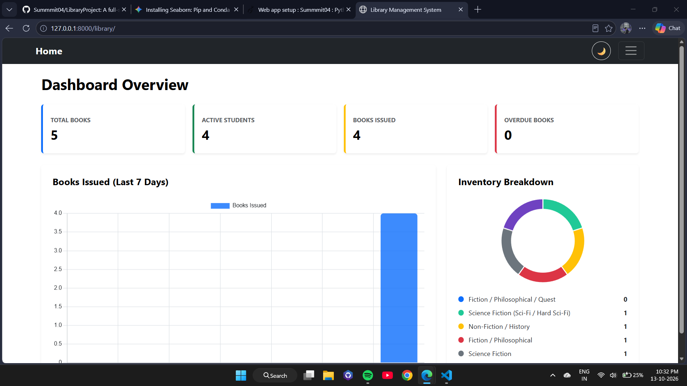
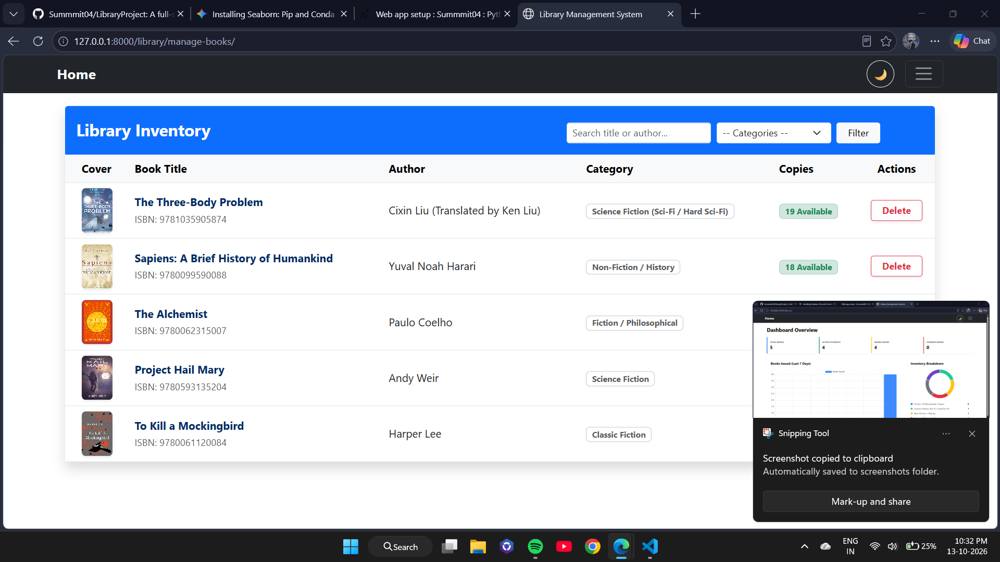
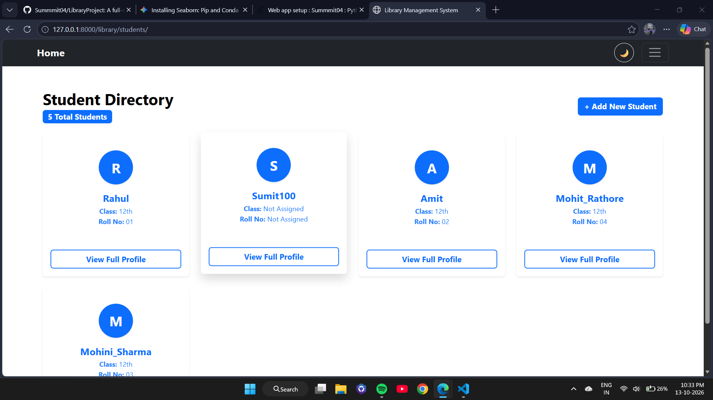
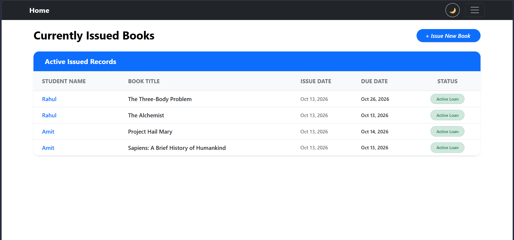

# 📚 Library Management System

A full-stack Django web application designed for managing library operations, tracking book issuance, calculating overdue fines, and providing student management. Built with robust backend logic and a modern responsive Bootstrap UI.

## 🌐 Live Demo
Check out the live deployment here: [Library Management System](https://summmit04.pythonanywhere.com)

## ✨ Features

- 🔐 **Authentication & Authorization**: Role-based views for Admin/Librarian and Students.
- 📖 **Book Management**: Full CRUD functionality for books, genres, and availability.
- ⏱️ **Issuance & Fine Calculation**: Automated overdue detection with dynamic daily fine calculation logic.
- 🌗 **Modern UI/UX**: Fully responsive Bootstrap UI supporting seamless Light & Dark mode toggle.
- 📊 **Dashboard**: Real-time analytics for current loans, overdue records, and student profiles.

## 🛠️ Tech Stack

- **Backend**: Python, Django
- **Frontend**: HTML5, CSS3, JavaScript, Bootstrap 5
- **Database**: SQLite
- **Version Control**: Git, GitHub

## 🚀 Quick Setup & Installation

```bash
# 1. Clone repository
git clone [https://github.com/Summmit04/LibraryProject.git](https://github.com/Summmit04/LibraryProject.git)
cd LibraryProject

# 2. Create and activate virtual environment
python -m venv venv
# On Windows:
venv\Scripts\activate

# 3. Install dependencies
pip install -r requirements.txt

# 4. Apply database migrations
python manage.py migrate

# 5. Run the development server
python manage.py runserver

## 📸 Application Screenshots

### 1. Analytics & Dashboard Overview


### 2. Library Inventory Management


### 3. Student Directory (Role-Based Isolation)


### 4. Active Issued Books Tracking
